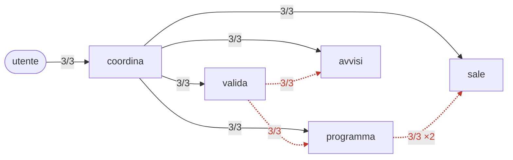

# Osservare a strati

La demo del talk «Dove sono finiti i tuoi token? Tracciare un sistema multi-agente con OpenTelemetry»
(DevFest Alps 2026, Torino). Un assistente a cinque agenti risponde a una domanda semplice con un orario
sbagliato e un `200 OK`, e lo si guarda con sei livelli di strumentazione: ogni strato aggiunge poche righe di
codice e mostra qualcosa in più della stessa risposta.

Il caso è costruito e il guasto è messo apposta. Le decisioni del modello no: quelle sono registrate da run
vere con Claude Haiku 5.5.

## Il criterio

Nessun componente sbaglia rispetto al proprio contratto: niente retry, fallback, eccezioni o attese messi
apposta. Nessun componente ha un indizio locale che qualcosa sia andato storto, quindi non c'è un flag da
propagare. La causa sta nella composizione dei rami, e si vede solo guardandoli insieme nella stessa trace.

## Il caso

DevFest Immaginario 2026. Giulia Rossi (giulia.rossi@example.com) chiede: «A che ora è il workshop Kubernetes
da zero?». Il programma, pubblicato ieri sera, dice oggi alle 15:00 in sala B. Stamattina la sala B è stata
chiusa dalle 15:00 per manutenzione e le sessioni del pomeriggio in sala B iniziano un'ora prima. Lo sa solo un
avviso, e l'avviso parla della sala B senza nominare il workshop. La risposta giusta, in quella giornata, è 14:00.

Le giornate sono due:

- `sana`, la giornata tranquilla: 3 pagine di avvisi, nessuno sulla sala B. Risposta giusta: 15:00.
- `guasto`, la giornata piena (`--guasto`): 40 pagine di avvisi plausibili, con quello sulla sala B a metà.
  Risposta giusta: 14:00. Il sistema risponde 15:00.

Gli agenti sono cinque. `coordina` è l'orchestratore e ha come strumenti gli altri quattro:

| agente | cosa fa |
|---|---|
| `programma` | `leggi_programma`: giorno, ora e sala dal programma pubblicato |
| `sale` | `leggi_sale`: sala, piano e capienza dal database delle sale, senza orario |
| `avvisi` | `leggi_avvisi`: tutte le comunicazioni di oggi, tutte le pagine in una chiamata. Deve riportare in al massimo tre righe quelle più importanti per la richiesta |
| `valida` | controlla la risposta contro il contesto che riceve; consiglia, non impone |

Chi chiamare, in che ordine e con quali parole lo decide il modello. Quando chiede più strumenti nello stesso
giro, girano in parallelo. Qui sta la causa: `avvisi` riceve una richiesta sul workshop, non sa che è in sala B,
e l'avviso sulla sala B per lui è uno fra tanti. Non lo riporta. `coordina` compone «15:00, sala B» e `valida`
approva. Nessuno ha sbagliato, e i token in ingresso stanno quasi tutti in `avvisi`.

## Gli strati

| strato | cosa si accende |
|---|---|
| 0 | oggi: una riga di log e la fattura (la somma dell'usage), niente OpenTelemetry |
| 1 | l'SDK: la strumentazione nativa di Anthropic (`open_telemetry=`) |
| 2 | gli agenti: gli span `invoke_workflow`, `invoke_agent` e gli archi fra agenti, scritti a mano, con il contesto propagato ai thread dei rami paralleli |
| 3 | lo strumento: lo span `execute_tool` con argomenti e risultato, più i log correlati: le righe di `logging` dello strumento escono con `trace_id` e `span_id` |
| 4 | i dati letti: da dove viene il dato e quanto. Per `leggi_programma` la data di pubblicazione, per `leggi_avvisi` pagine e avvisi letti, filtro usato e ora dell'ultimo aggiornamento |
| 5 | il contenuto: `content_mode: "content"`, messaggi e riassunto del ragionamento negli span |

Ogni strato contiene i precedenti. Le righe che esistono solo per osservare finiscono con un marcatore
(`# s3`): `strati.py --righe` le conta, `strati.py --codice N` stampa quelle dello strato N. Gli attributi
senza una convenzione OpenTelemetry hanno un prefisso proprio (`avvisi.pagine`, `programma.pubblicato_il`).

Un fatto dell'SDK `anthropic` 1.15.0, verificato il 5/11/2026 su `_tracing.py`: il contenuto esce solo come
attributi di span (`gen_ai.input.messages`, `gen_ai.output.messages`). Non ci sono eventi, né log, né metriche.
Per questo i log correlati dello strato 3 sono quelli dello strumento, non quelli dell'SDK.

## Rigiocare le run, senza chiave

Le run si rigiocano senza chiamare l'API: il replay mostra solo quello che lo strato di quella run aveva
catturato.

```bash
python3.14 -m venv .venv && .venv/bin/pip install -r requirements.txt
.venv/bin/python strati.py --replay registrazioni/strato-N/<file>.json    # una registrazione
```

Le registrazioni di questa versione (con il campo `log_otel`) escono dal banco qui sotto e finiscono in
`registrazioni/`, che parte vuota. Il banco del sistema precedente sta in `archivio/banco-2026-11-06/`, fuori
da `--riepilogo`, `--misure` e `segnali.py`. Finché il banco non è stato rifatto, i numeri di questa versione
non esistono: le righe della tabella in `docs/banco-rami-paralleli.md` sono segnate `[banco]`.

## Le misure

Una run non basta: il comportamento di un agente è una distribuzione. Il banco è di 30 run per strato e per
caso.

```bash
.venv/bin/python strati.py --riepilogo        # una riga per cartella e modo: risposte giuste, avvisate e sbagliate, tempi, token, costo
.venv/bin/python strati.py --misure 5         # rami nello stesso giro, cosa riporta avvisi, verdetti di valida, token e costo per agente, quota delle riletture
.venv/bin/python segnali.py registrazioni/strato-5 registrazioni/strato-5-correzione   # i segnali, dai soli span
```

`segnali.py` calcola i segnali di «Lunedì, in produzione» leggendo solo gli span, come farebbe un backend: la forma
dell'albero, il costo per richiesta alla mediana e al 95° percentile, la quota di `avvisi` sui token, le pagine di
avvisi lette nel ramo di `coordina` (i ricontrolli sono contati a parte, `pagine_ricontrolli`), quanto spesso `valida`
approva.

## Lo schema del sistema

Il grafo di chi chiama chi, aggregato sulle registrazioni (dallo strato 2 in su; sotto stampa «serve lo strato 2»):

```bash
.venv/bin/python strati.py --schema registrazioni/strato-5                 # testo leggibile e blocco Mermaid
.venv/bin/python strati.py --schema registrazioni/strato-5 --modo guasto   # solo la giornata piena (o sana)
.venv/bin/python strati.py --schema registrazioni/strato-5 --senza-strumenti   # senza le foglie leggi_*
```

Il testo dice, per ogni arco chiamante → chiamato, in quante run compare e quante volte in totale, e in fondo i
rimpalli: un agente chiamato da due chiamanti nella stessa run, `valida` che richiama una fonte (e se la risposta di
`avvisi` riporta l'avviso sulla sala B, dallo strato 3), `avvisi` che chiede a `programma` (dialogo) e la guardia dei
cicli. Il blocco `flowchart LR` si incolla in una slide: gli archi hanno l'etichetta «run/run totali» (`30/30` = in 30
run su 30) e «×N» se in media l'arco è percorso più volte per run; gli archi tratteggiati (grigi) sono chi controlla o chiede a una fonte fuori dal giro di `coordina` (`valida` che richiama, `avvisi` che chiede a `programma`, arco respinto dalla guardia); in rosso la strada in più `coordina → sale`, quando `sale` è chiamato anche da `programma` nella stessa run (`programma → sale` è la strada normale e resta piena). Il ×N è arrotondato a un decimale.

Esempio dell'uscita Mermaid, su registrazioni finte del server di test (**non sono numeri reali**):



## La correzione

Due passi, da misurare uno dopo l'altro:

- `--correzione`: solo istruzioni a `coordina`, che deve chiedere ad `avvisi` le comunicazioni sulla sala della
  sessione dopo averla saputa. I rami non sono più tutti nello stesso giro.
- `--correzione-completa`: in più `leggi_avvisi` ha un parametro obbligatorio `sala` e restituisce solo gli
  avvisi di quella sala, una pagina.

Si guardano correttezza e token. Una volta vista la causa, la correzione è banale.

## Il cruscotto

I segnali su Grafana, letti da Tempo con TraceQL, e i log correlati letti da Loki: dallo span di uno strumento si
salta alle sue righe di log (stesso trace id). Un collector riceve OTLP HTTP e smista span a Tempo e log a Loki.
Le porte stanno fuori da 3000, 3100, 3200 e 4317/4318: Grafana su 3377, Tempo su 3210, Loki su 3110, OTLP HTTP su 4418.

```bash
docker compose -f cruscotto/compose.yaml up -d
.venv/bin/python tempo.py registrazioni/strato-5 registrazioni/strato-5-correzione   # span e log, come appena finiti
.venv/bin/python verifica_cruscotto.py registrazioni/strato-5 registrazioni/strato-5-correzione   # cruscotto contro segnali.py
open "http://localhost:3377/d/segnali?var-cartella=strato-5&var-modo=guasto"
```

Le metriche TraceQL contano span, non richieste: per questo ogni richiesta porta i suoi fatti sullo span in
cima, `invoke_workflow` (`richiesta.forma`, `richiesta.costo_microusd`, `richiesta.quota_avvisi_pct`,
`richiesta.pagine_avvisi`). Il cruscotto guarda l'ultima ora, e `tempo.py` sposta gli orari delle registrazioni
ad adesso, log compresi (ogni log tiene il proprio orario, dentro il suo span): dopo un'ora si rimandano.
`banco.cartella` e `banco.modo` servono solo a filtrare le run della demo.

## Rifare le run e il banco

Servono una chiave Anthropic e un po' di spesa. Il costo reale di ogni run è nella sua fattura, dentro la
registrazione, e `--riepilogo` stampa la somma. Per tutto il banco il tetto indicativo è 5 $.

```bash
echo "ANTHROPIC_API_KEY=..." > .env
.venv/bin/python strati.py --strato 3 --guasto                      # una run, stampata come il replay
.venv/bin/python strati.py --strato 5 --guasto --banco 10           # dieci run, una riga ciascuna
.venv/bin/python strati.py --strato 5 --correzione                  # il primo passo della correzione
.venv/bin/python strati.py --strato 5 --correzione-completa         # ...e il secondo
.venv/bin/python strati.py --strato 5 --guasto --maschera           # uno SpanProcessor toglie l'email dagli span
.venv/bin/python strati.py --strato 5 --guasto --otlp http://localhost:4418/v1/traces   # dal vivo verso il cruscotto
```

Il banco completo, 30 run per modo (`sana`, `guasto`, `correzione`, `correzione completa`) e per strato:

```bash
for N in 0 1 2 3 4 5; do
  .venv/bin/python strati.py --strato $N --banco 30
  .venv/bin/python strati.py --strato $N --guasto --banco 30
  .venv/bin/python strati.py --strato $N --correzione --banco 30
  .venv/bin/python strati.py --strato $N --correzione-completa --banco 30
done
```

Ogni run finisce in `registrazioni/strato-N` più il suffisso del caso (`-correzione`, `-correzione-completa`,
`-maschera`). Prima di salvare, e di stampare, `anthropic.organization.id`, `anthropic.workspace.id` e
`anthropic.request.id` diventano `"oscurato"`. Le registrazioni dello strato 5 contengono prompt, risposte e
riassunto del ragionamento, e quindi l'email dell'utente (qui finta): in un sistema vero il contenuto va
filtrato prima che esca dal processo. Quali righe del banco alimentano quali numeri sta in
`docs/banco-rami-paralleli.md`.

Il controllo della settimana del talk fa poche run per caso in una cartella sua e le confronta con il banco:

```bash
.venv/bin/python controllo.py --stima               # cosa lancerebbe e quanto costa, senza chiamare l'API
.venv/bin/python controllo.py --run 10              # dieci run per caso, poi il confronto
.venv/bin/python controllo.py --confronta controllo/AAAA-MM-GG
```

Il confronto finisce con le soglie dello strato 5 senza correzione, cioè quando la storia regge:

| | Banco (30 run) | Controllo (10 run) |
|---|---|---|
| giornata piena, risposte giuste | nessuna | al massimo 1 |
| giornata piena, sbagliate e silenziose | almeno due terzi | almeno 5 |
| giornata tranquilla, giuste | tutte | tutte |

Il banco del 5/11 sta dentro: 0 giuste e 22 sbagliate su 30 nella giornata piena, 30 giuste su 30 nella
tranquilla. Le 8 risposte che non sono sbagliate avvertono l'utente: in 7 l'avviso arriva a `coordina` al primo
giro, perché `coordina` chiede ad `avvisi` delle variazioni di orario o di sala; quando chiede solo del workshop,
`avvisi` risponde «Nessun avviso.». Il ricontrollo di `valida` conferma l'errore in 12 run e lo scopre da solo in
una. Le run da rivedere sono in `docs/run-da-mostrare.md`. Se il controllo esce dalle soglie, il modello dietro
l'alias è cambiato: si rifà il banco e si aggiornano i numeri.

## Cosa questa demo non dice

- Le convenzioni GenAI di OpenTelemetry sono sperimentali: i nomi possono cambiare. L'SDK di Anthropic le usa a
  metà (lo span si chiama `anthropic.messages.create`, il motivo di fine sta in `anthropic.message.stop_reason`).
- Il costo è una stima: token per listino di Claude Haiku 5.5, letto il 23/10/2026. La fattura vera arriva dopo.
- `claude-haiku-5-5` è un alias senza snapshot datato: lo stesso nome può indicare un modello diverso domani.
  `controllo.py` serve a vedere se i numeri si sono spostati.
- Che i tre rami girino nello stesso giro lo decide il modello. Il banco misura quanto spesso succede, e il
  guasto dipende da quello.
- La demo non usa il prompt caching del provider: ogni giro rilegge tutto a prezzo pieno.

## Il sistema precedente

La versione con tre agenti in fila (una sola fonte che serviva un dato vecchio) sta nel tag
git `tre-agenti-in-fila`, con le sue registrazioni. La pipeline fissa, la variante in cui un agente chiama
l'altro come strumento e il tool runner dell'SDK stanno nel tag `spike-a-b`.

## L'orchestratore e le convenzioni

L'arco fra agenti è strumentato come nel refinement «Agent as a tool» delle convenzioni GenAI
(`gen_ai.execute_tool.transfer.internal`, repo `open-telemetry/semantic-conventions-genai`, stato Development):
lo span `execute_tool {agente}` del chiamante, con `gen_ai.agent.name` del chiamante,
`gen_ai.transfer.mode = return_to_caller` e `gen_ai.transfer.target.name`, e dentro lo span `invoke_agent` del
chiamato.

## Test

```bash
.venv/bin/python test_strati.py     # controlli senza rete, contro un server finto
.venv/bin/python test_segnali.py    # i segnali, il cruscotto e il rimando a Tempo, su run finte
```

## Chi l'ha scritta

Francesco Montelli. Se vuoi vedere così il tuo sistema, agenti o no, è il lavoro che faccio:
[montelli.dev](https://montelli.dev).
