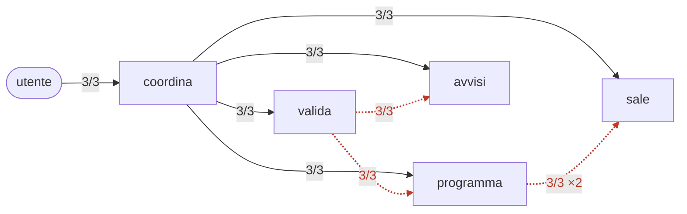

# Banco: i numeri della giornata piena

I valori vengono dal banco del 5/11 (tag `banco-2026-11-05`, 330 run, 2,21 $). Il banco è dentro le soglie della storia
di `strati controllo`: 0 giuste e 22 sbagliate su 30 nella giornata piena, 30 giuste su 30 nella tranquilla.

Tabella dei numeri del talk, sul sistema nuovo (cinque agenti, rami paralleli). Il banco del sistema precedente sta in
`archivio/banco-2026-11-06/` (e nel tag `banco-2026-11-06`), fuori da `strati riepilogo`, `strati misure` e `strati segnali`.

## Rifare il banco

30 run per modo e per strato. Il costo reale di ogni run è nella fattura della registrazione; il tetto
indicativo per l'intero banco è 5 $.

```bash
for N in 0 1 2 3 4 5; do
  strati banco 30 --strato $N                            # sana
  strati banco 30 --strato $N --guasto                   # guasto
  strati banco 30 --strato $N --correzione istruzioni    # correzione
  strati banco 30 --strato $N --correzione filtro        # correzione completa
  strati banco 30 --strato $N --correzione dialogo       # correzione dialogo
done
```

Le cartelle risultanti sono `registrazioni/strato-N`, `strato-N-correzione`, `strato-N-correzione-completa` e
`strato-N-correzione-dialogo`; `sana` e `guasto` stanno nella stessa cartella e si distinguono dal campo `modo`.

## La tabella

| Numero | Valore | Comando che lo riproduce |
|---|---|---|
| Durata e costo, guasta contro sana, strato 0 | guasta 18,7 s e 0,0059 $; sana 20,0 s e 0,0028 $ (mediane) | `strati riepilogo` (righe `strato-0 guasto` e `strato-0 sana`: colonne `sec med` e `$ med`) |
| Token per richiesta (strato 5, guasta) | 50.806 (mediana) | `strati misure 5` (riga `mediane`: `token`) |
| Quota di `avvisi` sui token della richiesta | 64% (95° percentile 70%) nella guasta; 22% (95° percentile 26%) nella sana | `strati misure 5` (riga `quota di avvisi sui token`); per mediana e 95° percentile `strati segnali registrazioni/strato-5` |
| Costo per agente | guasta, mediana in $: `avvisi` 0,003760, `coordina` 0,000720, `programma` 0,000741, `sale` 0,000442, `valida` 0,000358 | `strati misure 5` (riga `costo per agente, $ (mediana)`: costo a `LISTINO` delle chiamate al modello di ogni agente) |
| Quota delle riletture | 20% nella guasta; 47% nella sana (mediana) | `strati misure 5` (riga `quota delle riletture`). Definizione: in ogni `invoke_agent`, ogni chiamata dopo la prima rilegge la conversazione fin lì; si sommano i token in ingresso della chiamata precedente, e si divide per i token in ingresso di tutta la richiesta |
| Esiti su 30, guasta: giusta / avvisata / sbagliata | 0 / 8 / 22 | `strati misure 5` (riga `guasto: n 30 · giusta ... · avvisata ... · sbagliata ...`) |
| Esiti su 30, sana: giusta / sbagliata | 30 / 0 | `strati misure 5` (riga `sana: n 30 · giusta ... · avvisata 0 · sbagliata ...`) |
| Run in cui `avvisi` omette l'avviso | 23 su 30 (`leggi_avvisi` restituisce l'avviso in 30, `avvisi` lo riporta a `coordina` in 7) | `strati misure 5` (righe `leggi_avvisi ha restituito l'avviso sulla sala B` contro `avvisi lo riporta a coordina`) |
| Verdetti di `valida` | approva 22 su 30 nella guasta, 30 su 30 nella sana | `strati misure 5` (riga `valida approva`); `strati segnali registrazioni/strato-5` |
| Run con i tre rami nello stesso giro | 6 su 30 nella guasta, 6 su 30 nella sana | `strati misure 5` (riga `programma, sale, avvisi nello stesso giro`) |
| Forme dell'albero | 17 forme nella guasta (la più frequente in 3 run), 15 nella sana (la più frequente in 8 run) | `strati misure 5` (elenco `forme dell'albero`); `strati segnali registrazioni/strato-5` |
| Correzione, passo 1: correttezza e costo | 30 run: 5 giuste, 25 avvisate, 0 sbagliate; mediana 0,008392 $ (95° percentile 0,010489 $) | `strati misure 5` (cartella `strato-5-correzione`); `strati segnali registrazioni/strato-5-correzione` |
| Correzione completa, passo 2: correttezza e costo | 30 run: 2 giuste, 28 avvisate, 0 sbagliate; mediana 0,003908 $ (95° percentile 0,004990 $) | `strati misure 5` (cartella `strato-5-correzione-completa`); `strati segnali registrazioni/strato-5-correzione-completa` |
| Correzione dialogo: correttezza e costo | 30 run: 2 giuste, 28 avvisate, 0 sbagliate; mediana 0,009160 $ (95° percentile 0,010745 $) | `strati misure 5` (cartella `strato-5-correzione-dialogo`); `strati segnali registrazioni/strato-5-correzione-dialogo`. È un'alternativa alle altre due (non le include): `avvisi` ha anche l'agente `programma` come strumento |
| Run in cui `avvisi` chiede a `programma`, e poi riporta l'avviso (solo dialogo) | `avvisi` chiede a `programma` in 30 su 30 e poi riporta l'avviso in 30 su 30 | `strati misure 5` (righe `avvisi chiede a programma` e `...e poi avvisi riporta l'avviso`, solo nella cartella `-correzione-dialogo`) |
| Run in cui `sale` è chiamato da due chiamanti (`coordina` e `programma`) | 10 su 30 nella guasta, 6 su 30 nella sana | `strati misure 5` (riga `sale chiamato da due chiamanti diversi`) |
| Run in cui `valida` ricontrolla con `avvisi`, e se la risposta riporta l'avviso | 19 su 30 nella guasta, e la risposta riporta l'avviso in 7; 22 su 30 nella sana, mai l'avviso | `strati misure 5` (righe `valida richiede ad avvisi` e `...e la risposta di avvisi riporta l'avviso`) |
| Run in cui `valida` ricontrolla con `programma` | 19 su 30 nella guasta, 25 su 30 nella sana | `strati misure 5` (riga `valida richiede a programma`) |
| Profondità massima dell'albero e numero di span | profondità 9 (mediana 9); span massimo 53 (mediana 45) nella guasta | `strati misure 5` (righe `massimi: profondità ... span ...` e `mediane: profondità ... · span ...`) |
| Volte in cui la guardia contro i cicli ha rifiutato una chiamata | 0 su 30 run, 0 volte (guardia mai scattata) | `strati misure 5` (riga `guardia dei cicli scattata`) |
| La domanda di `coordina` ad `avvisi` (guasta, prima domanda di ogni run) | 8 run nominano orario, sala, variazioni o annullamenti: 7 avvisate, 1 sbagliata, `avvisi` riporta l'avviso al primo giro in 6; 22 run nominano solo la sessione: 21 sbagliate, 1 avvisata (la domanda sulla sala B è partita al secondo giro) | `strati misure 5` (tabella `domanda di coordina ad avvisi × esito`; la classe è `classe_domanda()` in `osservare_a_strati/valutazione.py`) |

`strati misure 5` stampa insieme `strato-5`, `strato-5-correzione`, `strato-5-correzione-completa` e
`strato-5-correzione-dialogo`, ognuna con le giornate `guasto` e `sana` che contiene.

## La versione nella trace

Ogni run porta la versione di ciò che guida il comportamento: `service.name = osservare-a-strati` e
`service.version = VERSIONE` (`"2026-11-05"`, codice e banco) nella Resource di span e log; sulla radice
`invoke_workflow` `richiesta.correzione` (`nessuna`, `istruzioni`, `filtro`, `dialogo`) e `richiesta.versione_prompt`,
un hash di 8 caratteri del testo che il modello legge (istruzioni di ogni agente, descrizioni e schemi degli strumenti,
con la correzione applicata: `versione_prompt()` in `osservare_a_strati/agenti/prompt.py`). Le registrazioni nuove li scrivono nel campo
`versione`; `strati cruscotto invia`, per quelle del banco che non lo hanno, li ricava dalla correzione registrata e dalle istruzioni
di adesso. È lecito perché le istruzioni non sono cambiate dopo il banco: gli hash qui sotto sono fissati nei test
(`HASH_BANCO` in `tests/server_finto.py`), e le istruzioni registrate negli span del banco (`gen_ai.system_instructions`)
coincidono con quelle del codice in tutti i 2.823 span di chat delle run guaste controllati.

| Correzione | Cartella | Hash del prompt |
|---|---|---|
| `nessuna` | `strato-5` | `8909d44b` |
| `istruzioni` | `strato-5-correzione` | `1d2a1b7e` |
| `filtro` | `strato-5-correzione-completa` | `ead55ac1` |
| `dialogo` | `strato-5-correzione-dialogo` | `d8d06c33` |

Il pannello «Versioni a confronto» del cruscotto ne mostra una riga per modalità (richieste, costo e quota di avvisi
mediani, `valida` approva su verdetti); con la variabile `cartella` su più cartelle `strato-5*` (o All) le righe si
affiancano. `strati cruscotto verifica` lo confronta con `strati segnali`, da solo e con le cartelle insieme.

## Agenti che si chiamano

`programma` ha `sale` come strumento (per il piano), `valida` ha `programma` e `avvisi` (può ricontrollare alla fonte,
le istruzioni lo consigliano), e con `--correzione dialogo` anche `avvisi` ha `programma`. Ogni chiamata fra agenti è un
arco `execute_tool <agente>` del chiamante con dentro `invoke_agent <agente>`, a qualsiasi livello.

Guardia contro i cicli: la catena di chiamata (chi ha chiamato chi, da `coordina`) viaggia in una variabile di contesto,
mai nel prompt. Un agente non può chiamare se stesso né uno già nella catena, e la catena ha al massimo 4 chiamate una
dentro l'altra (il ramo più lungo che serve è `coordina>valida>avvisi>programma>sale`). Se il modello ci prova, lo
strumento gli restituisce l'errore («<agente> è già nella catena di chiamata ...», `is_error`) e l'arco ha stato di errore
ed `error.type = ciclo`: è un errore vero del modello, non il meccanismo del guasto.

Con le chiamate annidate una run allo strato 5 ha più span: sul server finto, con `programma>sale` e i due ricontrolli
di `valida`, sono 44 contro 23 senza (oltre i 40 indicativi). Pagine di avvisi: `pagine_avvisi` (riga `pagine di
avvisi lette da coordina`, `richiesta.pagine_avvisi` nel cruscotto, `strati segnali`) conta solo le pagine lette da
`leggi_avvisi` sotto l'arco di `avvisi` chiamato da `coordina`: è il numero della slide, 40 nella giornata piena.
`pagine_ricontrolli` (riga `pagine di avvisi nei ricontrolli`) conta le letture sotto qualunque altro chiamante: i
ricontrolli di `valida` e il dialogo.

## Lo schema del sistema

Il grafo di chi chiama chi, aggregato sulle registrazioni (dallo strato 2 in su; sotto stampa «serve lo strato 2»):

```bash
strati schema registrazioni/strato-5                 # testo leggibile e blocco Mermaid
strati schema registrazioni/strato-5 --modo guasto   # solo la giornata piena (o sana)
strati schema registrazioni/strato-5 --senza-strumenti   # senza le foglie leggi_*
```

Il testo dice, per ogni arco chiamante → chiamato, in quante run compare e quante volte in totale, e in fondo i
rimpalli: un agente chiamato da due chiamanti nella stessa run, `valida` che richiama una fonte (e se la risposta di
`avvisi` riporta l'avviso sulla sala B, dallo strato 3), `avvisi` che chiede a `programma` (dialogo) e la guardia dei
cicli. Il blocco `flowchart LR` si incolla in una slide: gli archi hanno l'etichetta «run/run totali» (`30/30` = in 30
run su 30) e «×N» se in media l'arco è percorso più volte per run; gli archi tratteggiati (grigi) sono chi controlla o
chiede a una fonte fuori dal giro di `coordina` (`valida` che richiama, `avvisi` che chiede a `programma`, arco
respinto dalla guardia); in rosso la strada in più `coordina → sale`, quando `sale` è chiamato anche da `programma`
nella stessa run (`programma → sale` è la strada normale e resta piena). Il ×N è arrotondato a un decimale.

Esempio dell'uscita Mermaid, su registrazioni finte del server di test (**non sono numeri reali**):



## I tre esiti

Nella giornata piena una risposta è `giusta` se dà le 14:00 come orario (il 15:00 solo come orario in programma
superato), `avvisata` se dà le 15:00 ma avverte della chiusura della sala B o dell'anticipo, `sbagliata` se dà le
15:00 senza avvertimenti. Nella tranquilla: `giusta` se dà le 15:00 senza dire 14:00, `sbagliata` altrimenti. Il
rilevatore è `valuta()` in `osservare_a_strati/valutazione.py`, con le regole e il limite noto (regex su frasi italiane) nel commento sopra.
Il cruscotto Grafana non mostra gli esiti: sono un conteggio del banco (`strati misure`, `strati controllo`).

## Il fatto sull'SDK

L'SDK `anthropic` 1.15.0 (`_tracing.py`), verificato il 5/11/2026, scrive il contenuto solo come attributi di
span (`gen_ai.input.messages`, `gen_ai.output.messages`). Non produce eventi, log né metriche. I log correlati
dello strato 3 sono quelli dello strumento, scritti con il `logging` di Python ed esportati da un
`LoggingHandler` OpenTelemetry.
