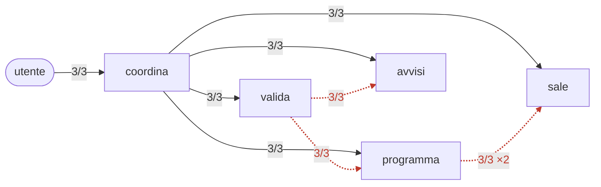

# Gli strati

La tabella di cosa accende ogni strato sta nel [README](../README.md#gli-strati).

Ogni strato contiene i precedenti. Le righe che esistono solo per osservare finiscono con un marcatore
(`# s3`): `strati righe` le conta, `strati codice N` stampa quelle dello strato N. Gli attributi
senza una convenzione OpenTelemetry hanno un prefisso proprio (`avvisi.pagine`, `programma.pubblicato_il`).

## Il fatto sull'SDK

Un fatto dell'SDK `anthropic` 1.15.0, verificato il 5/11/2026 su `_tracing.py`: il contenuto esce solo come
attributi di span (`gen_ai.input.messages`, `gen_ai.output.messages`). Non ci sono eventi, né log, né metriche.
Per questo i log correlati dello strato 3 sono quelli dello strumento e le righe per chiamata scritte dall'app, e le
metriche dello strato 1 le emette l'app: nessuna viene dall'SDK.

## Log e metriche

La riga per chiamata dello strato 0 esce da `logging` con i campi come `extra`; dallo strato 3 lo stesso handler di
OpenTelemetry la porta in Loki con `trace_id` e `span_id`, e i campi diventano metadati strutturati. In Loki la
richiesta si ritrova dal suo id e si somma per agente:

```logql
{service_name="osservare-a-strati"} | richiesta="7923fcc3"
sum by (gen_ai_agent_name) (sum_over_time({service_name="osservare-a-strati"} | richiesta="7923fcc3" | unwrap gen_ai_usage_input_tokens [1h]))
```

L'istogramma `assistente.agente.token` si registra dentro lo span della richiesta: dallo strato 2 ogni misura porta la
sua trace come exemplar, e da Prometheus si salta alla trace in Tempo.

## Lo schema del sistema

Il grafo di chi chiama chi, aggregato sulle registrazioni (dallo strato 2 in su; sotto stampa «serve lo strato 2»):

```bash
strati schema registrazioni/strato-5                 # testo leggibile e blocco Mermaid
strati schema registrazioni/strato-5 --modo guasto   # solo la giornata piena (o sana)
strati schema registrazioni/strato-5 --senza-strumenti   # senza le foglie leggi_*
```

Il testo dice, per ogni arco chiamante → chiamato, in quante run compare e quante volte in totale, e in fondo i
rimpalli: un agente chiamato da due chiamanti nella stessa run, `valida` che richiama una fonte (e se la risposta di
`avvisi` riporta l'avviso sulla sala B, dallo strato 3), `avvisi` che chiede a `programma` (dialogo) e la guardia dei
cicli. Il blocco `flowchart LR` si incolla in una slide: gli archi hanno l'etichetta «run/run totali» (`30/30` = in 30
run su 30) e «×N» se in media l'arco è percorso più volte per run; gli archi tratteggiati (grigi) sono chi controlla o chiede a una fonte fuori dal giro di `coordina` (`valida` che richiama, `avvisi` che chiede a `programma`, arco respinto dalla guardia); in rosso la strada in più `coordina → sale`, quando `sale` è chiamato anche da `programma` nella stessa run (`programma → sale` è la strada normale e resta piena). Il ×N è arrotondato a un decimale.

Esempio dell'uscita Mermaid, su registrazioni finte del server di test (**non sono numeri reali**):


